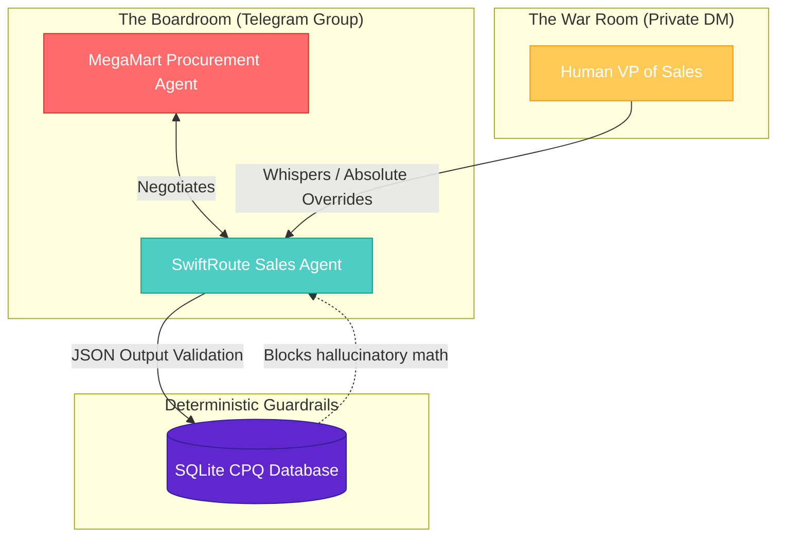
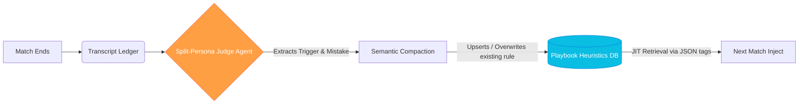

# ZeroLeak OS 🛡️

**Adversarial Multi-Agent Simulation for Enterprise Deal Desks.**

### The Bleed (The Problem)
Your junior Account Executives are bleeding 3% of your profit margin every time a veteran procurement buyer bluffs them on a Zoom call. They panic. They yield on RTO (Return to Origin) penalties. They give away 60-day payment terms for free. 

**That 30-second panic attack costs your logistics company ₹2 Crores a year.** 

You cannot train humans to handle extreme psychological pressure using PowerPoint. They have to feel the heat. 

### The Plug (The Solution)
ZeroLeak OS is a Neuro-Symbolic, Multi-Agent training arena. We drop your junior Sales Reps into a live Telegram environment against an aggressive, autonomous AI Procurement Buyer. 

*   If the rep panics and drops the price, the AI takes their fake money.
*   The human VP of Sales watches live in the "War Room" and whispers strategic overrides to the rep mid-negotiation.
*   Post-match, our asynchronous **Judge Agent** analyzes the transcript, extracts the margin-leakage mistakes, and compacts them into a self-pruning SQLite Memory Playbook for future matches.

---

### System Architecture (The Arena)

---

### Cognitive Memory Architecture (RLHF Loop)
Standard RAG pipelines bloat the LLM context window. ZeroLeak OS uses a Highlander Compaction Loop (O(1) memory growth) combined with In-Band Tagging for zero-latency retrieval.

### Key Technical Innovations

*   **Neuro-Symbolic Guardrails:** LLMs cannot do math. The AI is forced to output JSON (`proposed_price: 41`), which the Python orchestrator evaluates against the SQLite CPQ floor. If the LLM tries to go below the floor, the Python script intercepts the API call and forces a rewrite.

*   **Dynamic HITL Escalation:** If the Sales Agent hits a deadlock (5 turns without progress), the state-machine pauses the boardroom and pings the Human Manager for an absolute override decision ("Walk Away" vs "Close the deal").

*   **Split-Persona Evaluator:** To prevent Reward Model Bias, the post-match Judge Agent dynamically swaps its system prompt based on who it is auditing (VP of Sales vs. Head of Sourcing) to generate non-conflicting behavioral heuristics.
