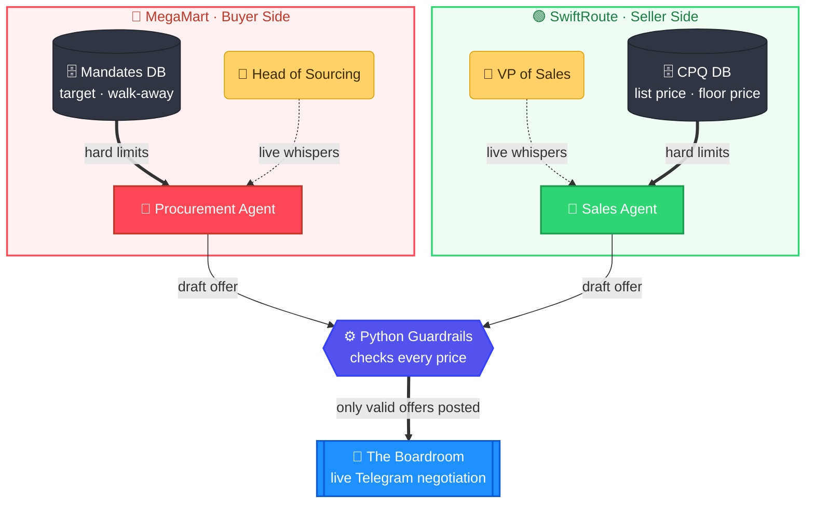
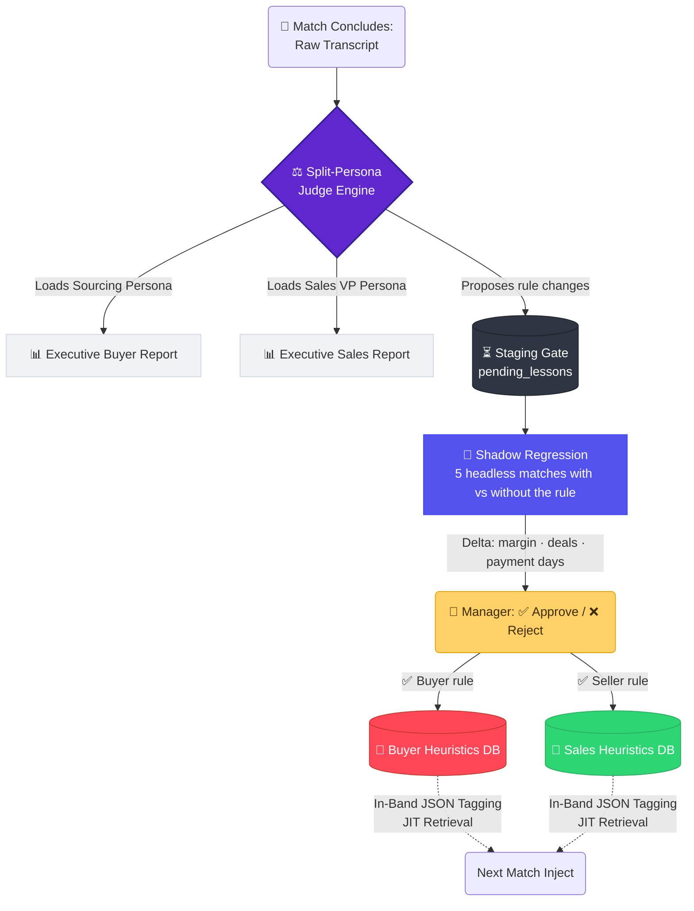

# ZeroLeak OS 🛡️

**Autonomous Multi-Agent Deal Desk for live enterprise contract negotiation.**

### The Bloodbath (The Problem)
Enterprise B2B negotiation is a zero-sum game plagued by human error and psychological pressure. 

*   **The Sales Bleed (Margin Leakage):** An Account Executive gets ambushed on a Zoom call by a veteran buyer. They panic and yield just **₹2 per parcel** on a 1.5M parcel/month contract to save the deal. That single 30-second mistake silently bleeds **₹3.6 Crores in pure profit annually** (1.5M x 12 months x ₹2) from a single account. Multiply that across a sales floor, and it is an EBITDA crisis.
*   **The Procurement Bleed (Cost Inefficiency):** Procurement teams fail to leverage market conditions or competitor quotes, overpaying for multi-year vendor lock-ins and failing to secure RTO (Return to Origin) waivers. 

Both sides leave millions on the table because every concession is made by a human under pressure, in real time, with nothing between the impulse and the signed contract.

### The Engine (The Solution)
ZeroLeak OS is an Autonomous Multi-Agent Deal Desk for live enterprise contract negotiation. Two autonomous, data-driven AI agents negotiate the contract on Telegram: **SwiftRoute Logistics (Sales)** vs. **MegaMart (Procurement)**.

Both agents negotiate fiercely from distinct SQLite systems of record (CPQ floors vs. Target Mandates), and every offer is checked against hard limits before the other side sees it. Human executives (VP of Sales & Head of Sourcing) stay in the loop from isolated "War Rooms," whispering strategic overrides to their own agent in real time and answering escalations. Post-match, our Split-Persona Judge audits the transcript, sends tailored executive reports to both department heads, and proposes playbook updates that go live only after a shadow regression test and the manager's explicit approval.

---

### Symmetrical Architecture (The Deal Desk)

### Cognitive Memory, Staging Gate & Dual Executive Reporting

ZeroLeak OS features a Split-Persona Judge Agent. Because negotiation is zero-sum, a single AI judge would suffer from Reward Model Bias. We solve this by splitting the Judge's personality post-match to audit each agent independently.

Because these agents negotiate real contracts, **memory regression** (the Judge overwriting a good rule with a worse one) is a financial risk. So the Judge never writes the live playbook: every proposed change waits in a staging table, is shadow-tested headless against the current rule, and goes live only when the human manager taps ✅ Approve.

### Key Technical Innovations

1. **Symmetrical JIT (Just-In-Time) Retrieval:** To prevent LLM context-bloat, agents use In-Band JSON tagging (`"current_friction_points": ["RTO", "Price"]`). The Orchestrator intercepts these tags to fetch only the relevant opponent heuristics for the next turn. Memory stays at O(1).
2. **Dual-Way HITL Escalation:** If either agent hits a mathematical deadlock or is pushed to their absolute walk-away limit, they automatically pause the Boardroom and ping their respective Human Manager (in that side's own War Room) for a final decision ("Walk Away" vs "Close the gap"). The decision becomes an absolute override for the rest of the negotiation.
3. **Neuro-Symbolic Guardrails:** The LLM's pricing outputs are constrained by deterministic Python logic. If an agent hallucinates a price outside its SQLite limits, the API call is intercepted and blocked before the opponent ever sees it.
4. **HITL Memory Staging Gate + Shadow Regression:** No rule reaches a live agent on the Judge's word alone. Each proposal is played 5 matches with and 5 without (AI vs AI, interleaved, on database copies), and the manager approves with the measured delta in front of them: *"🧠 Playbook Update Proposed. Shadow Test: Avg closing margin ₹1 → ₹1.5/parcel (+₹0.5/parcel). ✅ Approve / ❌ Reject"*.
