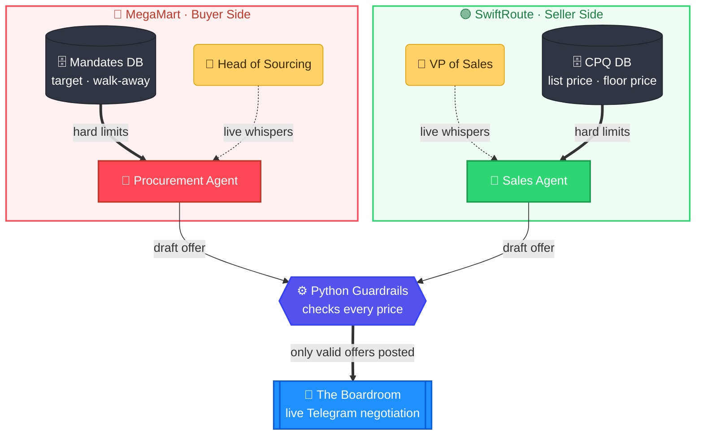
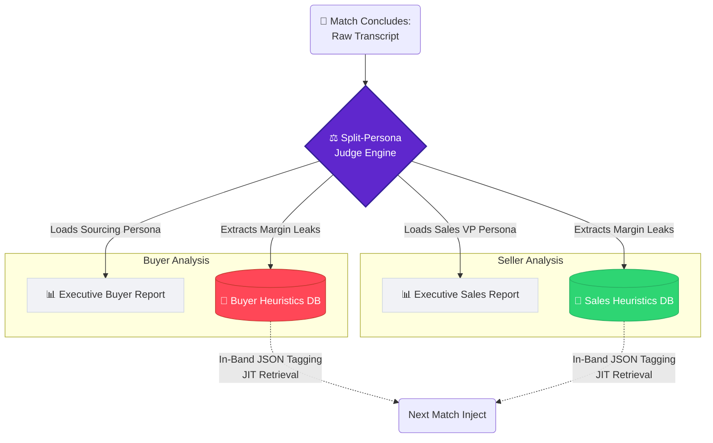

# ZeroLeak OS 🛡️

**Symmetrical Adversarial Multi-Agent Engine for B2B Deal Desks.**

### The Bloodbath (The Problem)
Enterprise B2B negotiation is a zero-sum game plagued by human error and psychological pressure. 

*   **The Sales Bleed (Margin Leakage):** A junior Account Executive gets ambushed on a Zoom call by a veteran buyer. They panic and yield just **₹2 per parcel** on a 1.5M parcel/month contract to save the deal. That single 30-second mistake silently bleeds **₹3.6 Crores in pure profit annually** (1.5M x 12 months x ₹2) from a single account. Multiply that across a sales floor, and it is an EBITDA crisis.
*   **The Procurement Bleed (Cost Inefficiency):** Junior Procurement Officers fail to leverage market conditions or competitor quotes, overpaying for multi-year vendor lock-ins and failing to secure RTO (Return to Origin) waivers. 

Both sides are leaving millions on the table because, right now, their only practice arena is when real money is on the line.

### The Engine (The Solution)
ZeroLeak OS is a Neuro-Symbolic, Adversarial Self-Play Arena. We deploy two autonomous, data-driven AI agents against each other in a live Telegram environment: **SwiftRoute Logistics (Sales)** vs. **MegaMart (Procurement)**.

Both agents negotiate fiercely based on distinct SQLite databases (CPQ floors vs. Target Mandates). Meanwhile, human executives (VP of Sales & Head of Sourcing) sit in isolated "War Rooms," whispering strategic overrides to their respective AIs in real-time. Post-match, our Split-Persona Judge audits the transcript and sends tailored executive reports to both department heads.

---

### Symmetrical Architecture (The Arena)

### Cognitive Memory & Dual Executive Reporting

ZeroLeak OS features a Split-Persona Judge Agent. Because negotiation is zero-sum, a single AI judge would suffer from Reward Model Bias. We solve this by splitting the Judge's personality post-match to audit each agent independently.

### Key Technical Innovations

1. **Symmetrical JIT (Just-In-Time) Retrieval:** To prevent LLM context-bloat, agents use In-Band JSON tagging (`"current_friction_points": ["RTO", "Price"]`). The Orchestrator intercepts these tags to fetch only the relevant opponent heuristics for the next turn. Memory stays at O(1).
2. **Dual-Way HITL Escalation:** If either agent hits a mathematical deadlock or is pushed to their absolute walk-away limit, they automatically pause the Boardroom and ping their respective Human Manager for a final decision ("Walk Away" vs "Close the gap").
3. **Neuro-Symbolic Guardrails:** The LLM's pricing outputs are constrained by deterministic Python logic. If an agent hallucinates a price outside its SQLite limits, the API call is intercepted and blocked before the opponent ever sees it.
