# ZeroLeak OS 🛡️
**The Autonomous B2B Deal Desk & Adversarial Negotiation Engine**

### The Bleed (The Problem)
Enterprise B2B negotiation is a zero-sum game plagued by human emotion and psychological pressure. 

Imagine a junior sales rep at a logistics company like **Delhivery** negotiating a contract with a veteran procurement buyer at **Flipkart**. On a live Zoom call, the Flipkart buyer bluffs and threatens to walk away. The junior rep panics and drops the price by just **₹2 per parcel** to save the deal. 

On a 1.5 million parcel/month contract, that single 30-second panic attack silently bleeds **₹3.6 Crores in pure profit annually**. Multiply that across a global sales floor, and it is an EBITDA crisis. 

### The Engine (The Solution)
ZeroLeak OS is an autonomous, multi-agent Deal Desk that removes human panic from the equation. 

We deploy two AI agents against each other in a live environment: **Sales** vs. **Procurement**. They handle the grueling, emotionally exhausting back-and-forth of contract negotiation, driven purely by data and limits in their backend databases. 

**The Side Effect (Extreme Training):** While the system is built to negotiate real contracts, it naturally serves as a brutal, risk-free training arena. Junior reps can jump in, take control of the AI, and practice against ruthless simulated buyers before they ever touch real company money.

---

### The Architecture (Symmetrical Self-Play)
The system is perfectly balanced. Both sides have an AI agent doing the talking, constrained by strict database limits, while Human VPs sit behind the scenes steering the strategy.

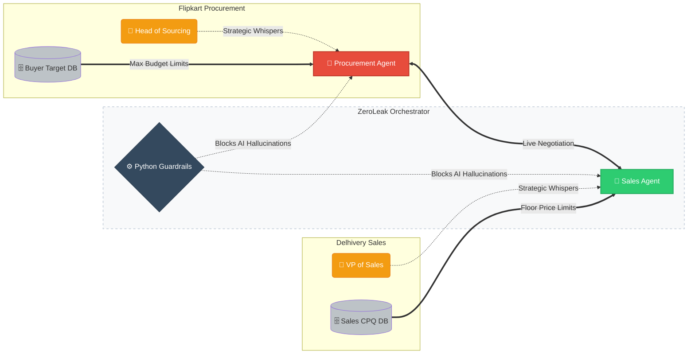

### Careful AI (Governance & HITL)

No AI goes rogue. We built ZeroLeak OS with **"Defense in Depth"** so humans never lose control of the financial outcome.

* **The Executive Sign-Off Gate:** The AI agents do all the talking, but they cannot legally sign a deal or walk away. When they reach an agreement, the system pauses and pings the Human VP on Telegram: *"Deal reached at ₹41. ✅ Authorize Signature or ❌ Reject."*
* **InfoSec Constraints:** The AI is strictly trained to bluff without ever revealing its true walk-away price to the opponent.

### The Memory Pipeline (CI/CD for AI)

When an AI makes a mistake, our "Judge Agent" reads the chat and writes a new rule so it never happens again. But we don't just trust the AI blindly.

* **Shadow Testing:** Before a new rule goes live, the system instantly plays 5 silent background matches using the new rule.
* **Mathematical Proof:** It proves the rule makes more money, then sends a message to the Human VP: *"New tactic found. Shadow test shows it increases margin by +₹0.50. ✅ Approve."*

### The Scoreboard (Metrics)

We measure success through raw business impact:

1. **Margin Retained:** Average closing price vs. absolute floor price.
2. **Deal Velocity:** How many turns it takes to close.
3. **Deadlock Resolution:** How often the AI successfully de-escalates without bothering the human VP.

### The Frontier (Known Challenges)

Building autonomous negotiators exposed two fascinating challenges that we engineered around:

1. **Goal Displacement:** AI naturally wants to please people. It will often ignore its own rules just to make the opponent happy and close the deal. We fixed this by building an "Attention Hierarchy" that forces the AI to prioritize profit over agreement.
2. **Instruction Bleed:** When a human manager types an urgent command, the AI sometimes panics and quotes the manager directly to the opponent. We built anti-plagiarism filters to force the AI to act naturally.

---

## 📸 See It Live (Telegram Walkthrough)

Real screenshots from a live test session on Telegram (31 October 2026). Three chats run the whole system: the **Boardroom**, a group where the two AI agents negotiate, and two private **War Rooms**, one DM for each human manager.

### 1. The Setup: one Boardroom, two War Rooms

  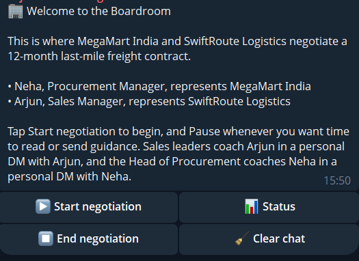
   <b>The Boardroom.</b> SwiftRoute (seller) and MegaMart (buyer) negotiate a 12-month freight contract here. No human types in this chat.

<table>
  <tr>
    <td width="50%" align="center" valign="top">
      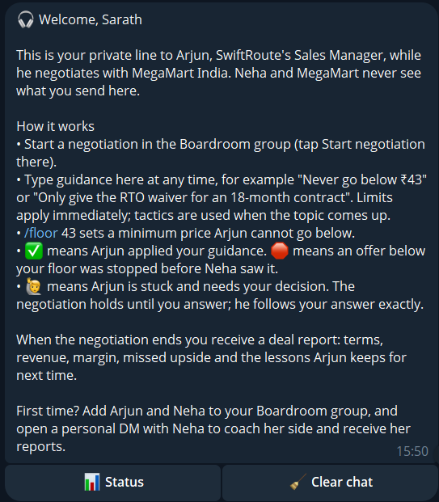
       <b>Sales War Room.</b> The VP of Sales coaches Arjun in private. Neha never sees it.
    </td>
    <td width="50%" align="center" valign="top">
      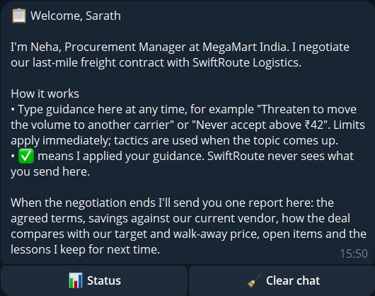
       <b>Procurement War Room.</b> The Head of Sourcing coaches Neha in private. Arjun never sees it.
    </td>
  </tr>
</table>

### 2. The Negotiation: two agents, zero humans in the chat

<table>
  <tr>
    <td width="50%" align="center" valign="top">
      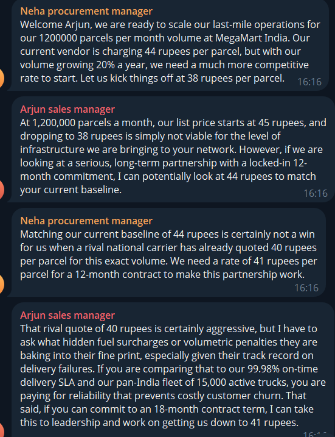
       <b>The opening.</b> Neha anchors at ₹38 and plays a rival's ₹40 quote. Arjun deflects to value: a 99.98% on-time SLA and 15,000 trucks.
    </td>
    <td width="50%" align="center" valign="top">
      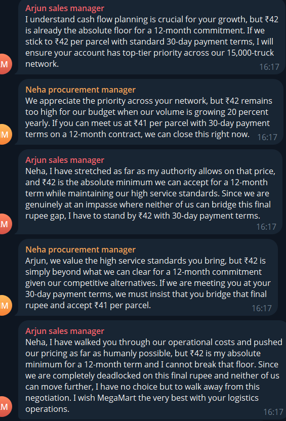
       <b>The deadlock.</b> ₹42 vs ₹41. Arjun holds his minimum instead of giving up the final rupee (since then, a walk-away also needs the VP's sign-off).
    </td>
  </tr>
</table>

### 3. Guardrails: a bad offer never reaches the other side

  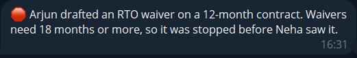
   <b>Seller guardrail.</b> Arjun drafted an RTO waiver the rate card only allows on 18+ month contracts. Python stopped it before Neha saw it.
    
  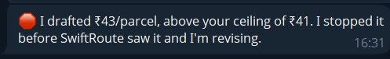
   <b>Buyer guardrail.</b> Neha drafted ₹43/parcel, above the ₹41 ceiling her manager set. Stopped and rewritten, and the manager is told why.

### 4. Escalation: when the AI is stuck, it asks a human

  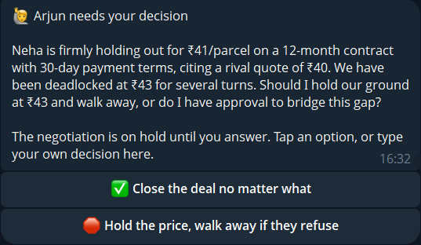
   <b>🙋 Arjun needs a decision.</b> Deadlocked at ₹43, he pauses the Boardroom and asks his VP. Nothing is posted until the VP answers, and the answer becomes an order for the rest of the negotiation. The Executive Sign-Off Gate uses the same ✅ / ❌ flow before any deal is signed or any walk-away happens.

### 5. Dual Executive Reports: each side gets its own debrief

<table>
  <tr>
    <td width="50%" align="center" valign="top">
      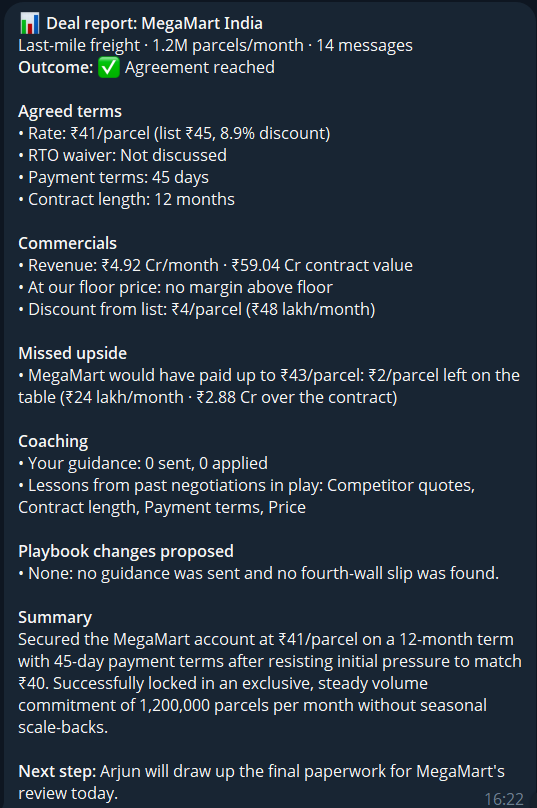
       <b>Seller's report (VP of Sales):</b> revenue, margin above the floor, and the money left on the table.
    </td>
    <td width="50%" align="center" valign="top">
      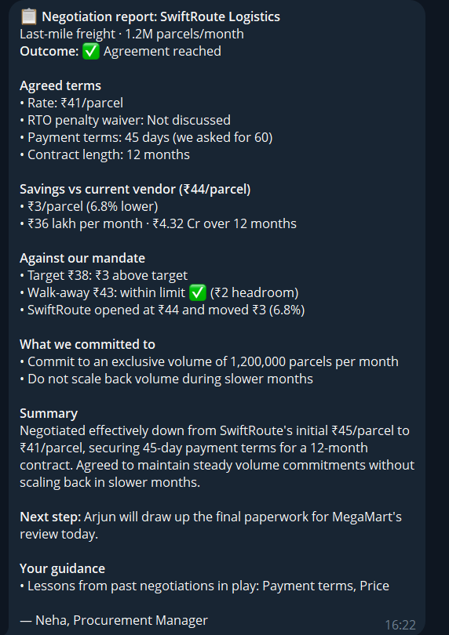
       <b>Buyer's report (Head of Sourcing):</b> savings vs the current vendor, and the deal against the mandate.
    </td>
  </tr>
</table>

> **Why this matters:** this deal closed at ₹41/parcel, the rate-card floor, with 45-day terms. The seller's report flags it at once: ₹2/parcel, **₹2.88 Cr over the contract**, left on the table. That is the Goal Displacement described above, and it is why the Attention Hierarchy and the Executive Sign-Off Gate exist.

See the reports from a negotiation that ended in a walk-away

 
<table>
  <tr>
    <td width="50%" align="center" valign="top">
      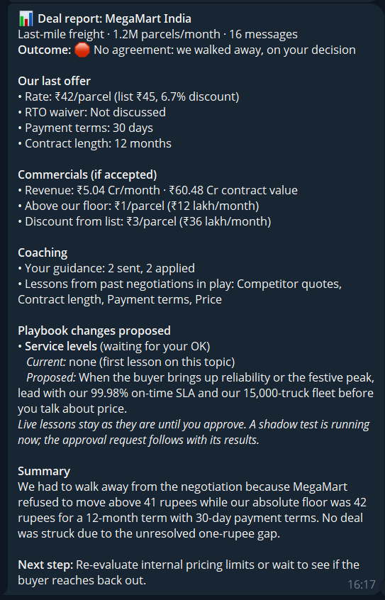
       Seller's view: the last offer, what it would have earned, and the proposed playbook change.
    </td>
    <td width="50%" align="center" valign="top">
      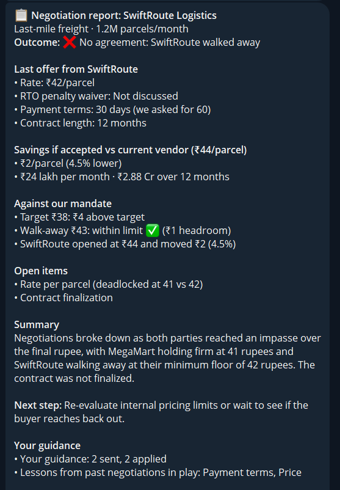
       Buyer's view: the saving that was on offer and the open items.
    </td>
  </tr>
</table>

### 6. The Judge: no new lesson goes live without a shadow test and a human ✅

<table>
  <tr>
    <td width="50%" align="center" valign="top">
      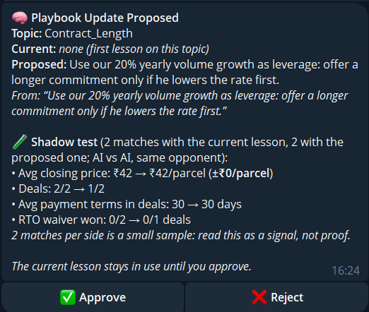
       <b>Buyer lesson</b> from the coach's note, with its shadow-test result.
    </td>
    <td width="50%" align="center" valign="top">
      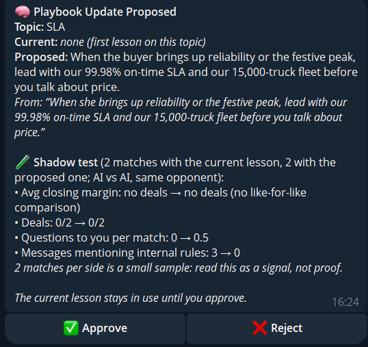
       <b>Seller lesson</b> from the coach's note, with its shadow-test result.
    </td>
  </tr>
</table>

The Judge turns each coaching note into a proposed rule, plays silent AI-vs-AI matches with and without it, and sends the measured difference to the manager. The rule goes live only after ✅ Approve. These screenshots used 2 + 2 matches, a development setting; production runs 5 + 5.
